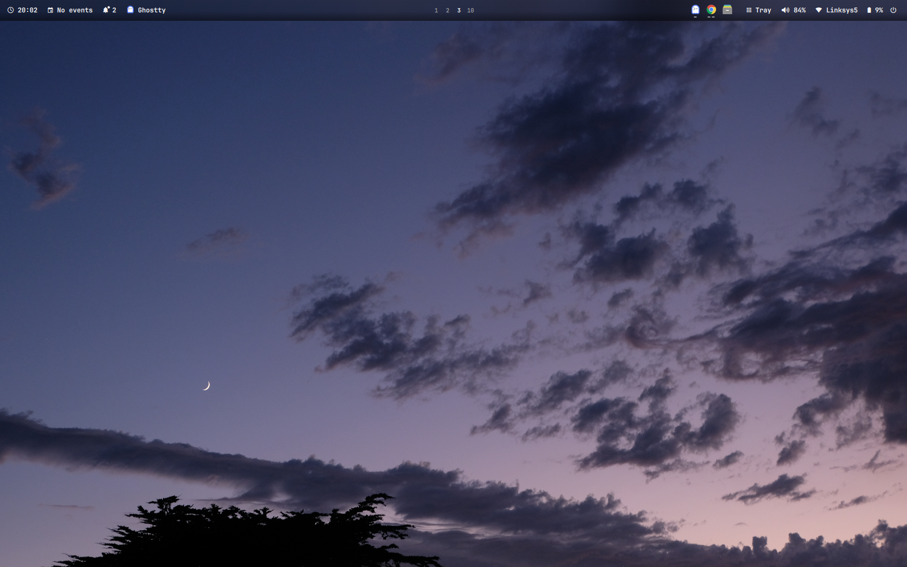

# NixOS Configuration

Personal NixOS and Home Manager configuration for the `laptop` and `pc` hosts.
It assumes the `aleks` user and host-specific hardware, monitor, and storage
layouts, so it is a reference rather than a drop-in configuration.



## Desktop

- Hyprland with host-specific monitor and workspace layouts.
- Nix-managed Quickshell desktop shell: top bar, application/file/emoji/clipboard
  launcher, dock, notifications, calendar, media controls, network/Tailscale/battery
  status, night-light toggle, and power menu. Click-open top-bar panels close
  after the pointer leaves their trigger and panel.
- Google Chrome by default, plus Firefox.
- Ghostty, Nautilus, Hyprlock, SwayOSD, Catppuccin/Papirus theming with
  wallpaper-driven dynamic Qt/KDE palettes (`quickshell-wallpaper-theme`), and
  KDE Connect.
- Syncthing for `~/ObsidianVault` between hosts.
- Declarative agent configurations (OpenCode, Antigravity `agy`, Codex, Claude,
  Cursor, and `rtk`) managed by Home Manager.

Quickshell's static configuration is built from
`configuration/applications/quickshell/config/minimal` together with
Nix-generated `Config.qml` and launcher file search lists, and deployed to
`~/.config/quickshell/default`. Mutable dock pins live at
`~/.local/state/quickshell/dock-pins.json`, and dynamic wallpaper theme state is
generated in `~/.local/state/quickshell/wallpaper-theme/`.

### Quickshell Options

`configuration/applications/quickshell/configuration.nix` exposes
`desktop.quickshell.*` NixOS options:

| Option | Default | Description |
| --- | --- | --- |
| `desktop.quickshell.enable` | `true` | Enable the Quickshell desktop shell |
| `desktop.quickshell.launcher.applications` | `true` | Enable application search in the launcher |
| `desktop.quickshell.launcher.files` | `true` | Enable file search in the launcher |
| `desktop.quickshell.launcher.emoji` | `true` | Enable emoji search in the launcher |
| `desktop.quickshell.launcher.clipboard` | `true` | Enable clipboard history in the launcher |
| `desktop.quickshell.launcher.fileSearch.paths` | `[ "Downloads" ]` | Home-relative or absolute paths searched by the file launcher |
| `desktop.quickshell.launcher.fileSearch.excludes` |*(common build/VCS dirs)* | `fd` exclusion patterns for launcher file search |
| `desktop.quickshell.notifications.popupTimeout` | `4800` | Notification popup timeout in milliseconds |
| `desktop.quickshell.notifications.queueLimit` | `20` | Maximum queued notification popups |
| `desktop.quickshell.nightLight.enable` | `true` | Expose night-light controls |
| `desktop.quickshell.nightLight.temperature` | `3500` | Night-light color temperature in Kelvin |
| `desktop.quickshell.network.tailscale` | `true` | Expose the Tailscale connection toggle |
| `desktop.quickshell.appMenu.enable` | `true` | Enable application menus |
| `desktop.quickshell.appMenu.nativeMenus` | `true` | Prefer native application menus when available |

Agent configurations for OpenCode, Antigravity (`agy`), Codex, Claude, and
Cursor are managed under `agents/` with a shared `agents/AGENTS.md` and
`agents/skills/` directory linked into each tool's configuration path via Home
Manager.

## Syncthing

Syncthing runs as `aleks` on both hosts and syncs `~/ObsidianVault`. Its web UI
is local-only at <http://127.0.0.1:8384>; firewall ports are open for device
discovery and transfers, not the web UI.

Start with the existing vault on one host only and let Syncthing populate the
other:

1. Rebuild both hosts and open <http://127.0.0.1:8384> on each.
2. On one host, select **Actions > Show ID** and copy its device ID.
3. On the other, select **Add Remote Device**, enter the ID and a recognizable
   name, then save.
4. Accept the pending device request on the first host.
5. On the host with the vault, select **Add Folder**, set the path to
   `/home/aleks/ObsidianVault`, select the other device under **Sharing**, and
   save.
6. Accept the folder request on the other host and use the same path.
7. When both report **Up to Date**, open the directory as an Obsidian vault on
   each host.

Check service status and logs with:

```bash
systemctl status syncthing.service
journalctl -u syncthing.service -f
```

## Repository Layout

| Path | Purpose |
| --- | --- |
| `flake.nix` | Flake inputs and NixOS host outputs |
| `devices/core.nix` | Shared system and application imports |
| `devices/laptop.nix` | Laptop hardware and host-specific settings (`NIXOS_HOST = "laptop"`) |
| `devices/pc.nix` | PC hardware and host-specific settings (`NIXOS_HOST = "pc"`) |
| `configuration/nixconfig/` | Core NixOS system modules |
| `configuration/nvidia/` | NVIDIA GPU configuration imported by `devices/pc.nix` |
| `configuration/applications/` | Application-specific system and Home Manager modules |
| `configuration/homemanagerconfig/` | Shared user environment, dynamic theme, and desktop entry configuration |
| `packages/pommy/` | Custom Rust Pomodoro CLI package built via Cargo |
| `home.nix` | Home Manager root for `aleks` |
| `agents/` | Declarative agent configurations (OpenCode, `agy`, Codex, Claude, Cursor, shared skills, and rules) |
| `Makefile` | Self-documenting operational, validation, and lint tasks routed via `NIXOS_HOST` |
| `RootMakefile` | Standalone host utility tasks (`make -f RootMakefile <target>`) |

## Keybindings

The leader key is Super.

| Key | Action |
| --- | --- |
| `Super+1` to `Super+0` | Switch to workspace 1–10 |
| `Super+Shift+1` to `Super+Shift+0` | Move the active window to workspace 1–10 |
| `Super+S` | Toggle the special workspace |
| `Super+Shift+S` | Move the active window to the special workspace |
| `Super+Space` | Open the Quickshell launcher |
| `Super+N` | Toggle the Quickshell notification center |
| `Super+Q` | Open Ghostty |
| `Super+W` | Open Google Chrome |
| `Super+E` | Open Nautilus |
| `Super+C` | Close the active window |
| `Super+V` | Toggle floating mode |
| `Super+F` | Toggle fullscreen |
| `Super+H/J/K/L` | Move focus |
| `Super+Shift+H/J/K/L` | Move the active window |
| `Alt+H/J/K/L` | Resize the active window |
| `Alt+Space` | Toggle media playback |
| `Print` or `Ctrl+Shift+4` | Capture a region |
| `Shift+Print` | Capture a window |
| `XF86AudioRaiseVolume` / `XF86AudioLowerVolume` | Raise or lower output volume (SwayOSD) |
| `XF86AudioMute` / `XF86AudioMicMute` | Toggle output or microphone mute (SwayOSD) |
| `XF86MonBrightnessUp` / `XF86MonBrightnessDown` | Raise or lower screen brightness (SwayOSD) |

## Installation

1. Clone the repository.
2. Review the username, hardware configuration, boot device, monitor names,
   storage mounts, and host-specific settings in `devices/`.
3. For initial bootstrap before `NIXOS_HOST` is active in the environment, pass
   `NIXOS_HOST=<host>` explicitly:
   - Dry-run: `make dry-run NIXOS_HOST=<host>`
   - Switch: `sudo nixos-rebuild switch --flake .#<host>`
4. Once activated, `NIXOS_HOST` is exported by the host configuration and `make`
   targets route automatically.

## Commands

Run `make` or `make help` to list all available targets:

| Command | Behavior |
| --- | --- |
| `make` / `make help` | Show available targets |
| `make rebuild` | Stage changes and rebuild the active `$(NIXOS_HOST)` configuration |
| `make dry-run` | Dry-run build the active `$(NIXOS_HOST)` configuration |
| `make check` | Evaluate the flake and run checks (`nix flake check`) |
| `make fmt` | Check Nix formatting with `nixfmt-rfc-style` |
| `make lint` | Run `statix` and `shellcheck` linters |
| `make update` | Update all flake inputs |
| `make clean` | Wipe old user/system profile history and collect garbage |
| `make git MSG="message"` | Stage, commit, and push to `origin/main` |
| `make all MSG="message"` | Update flake inputs, commit/push, and rebuild `$(NIXOS_HOST)` |

`make git` and `make all` push changes; `make clean` removes old generations.
Review their recipes before use. Run standalone utilities in `RootMakefile` with
`make -f RootMakefile <target>`.
